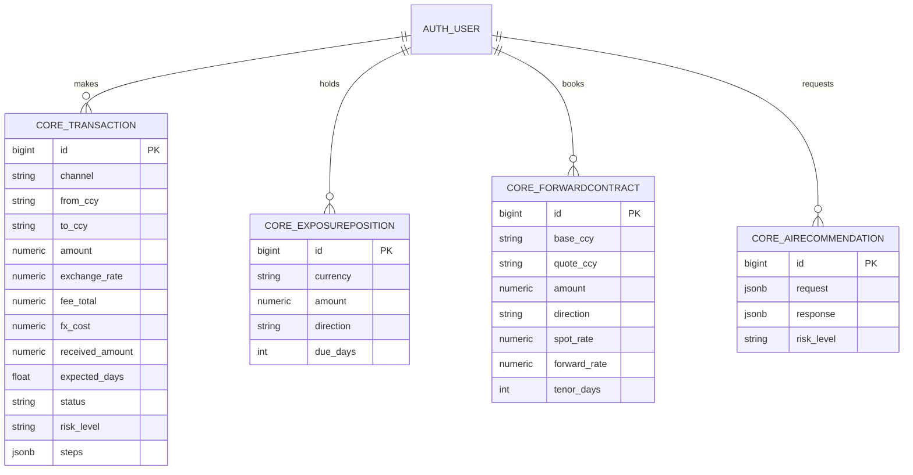

# Database Schema
Full DDL: [`schema.sql`](schema.sql). Django generates the same tables via migrations.

Reference data (currencies, volatility, country risk, provider fee tables) lives in code (`services/market.py`, `services/payments.py`) so it is version-controlled and unit-tested.
