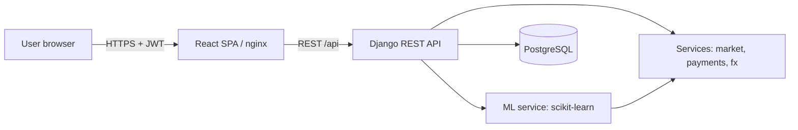
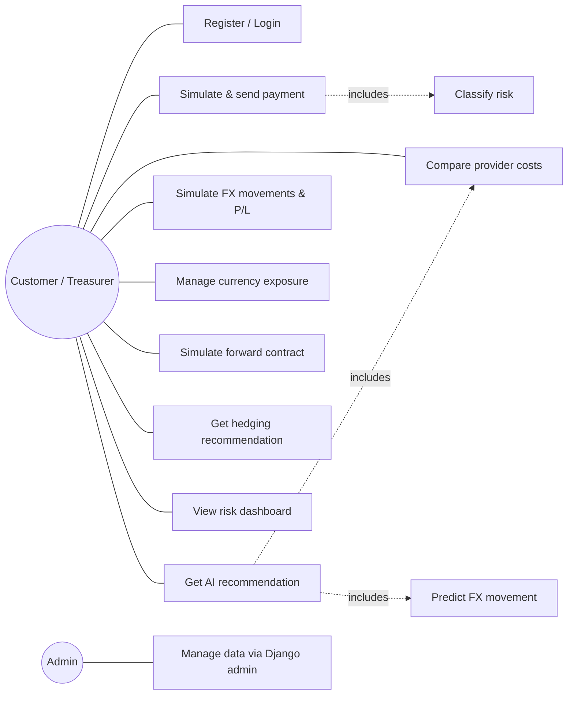
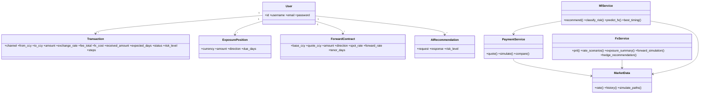
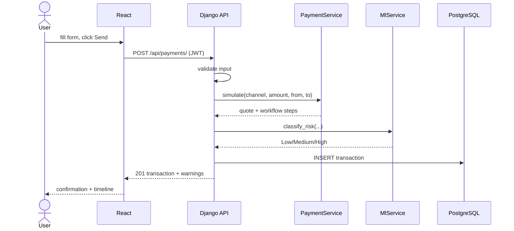
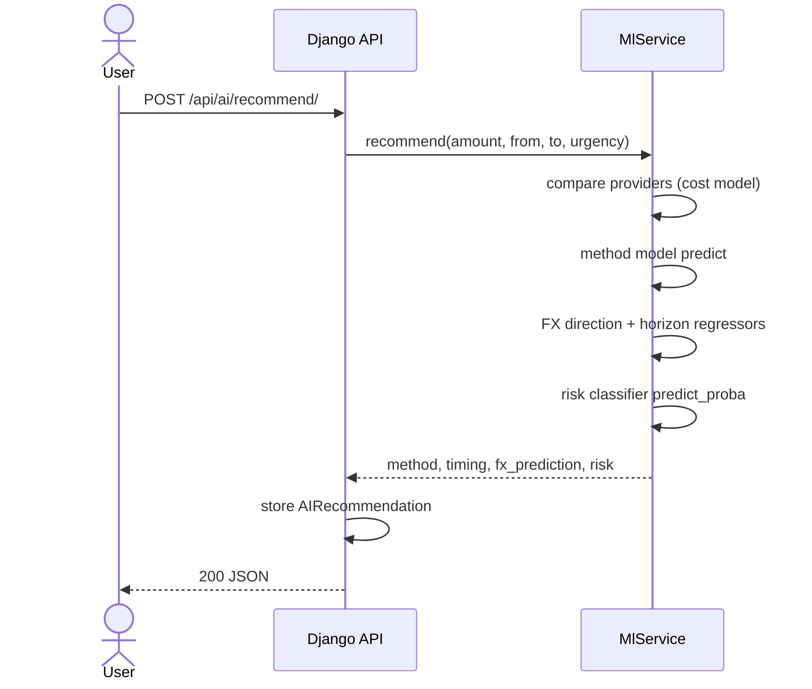
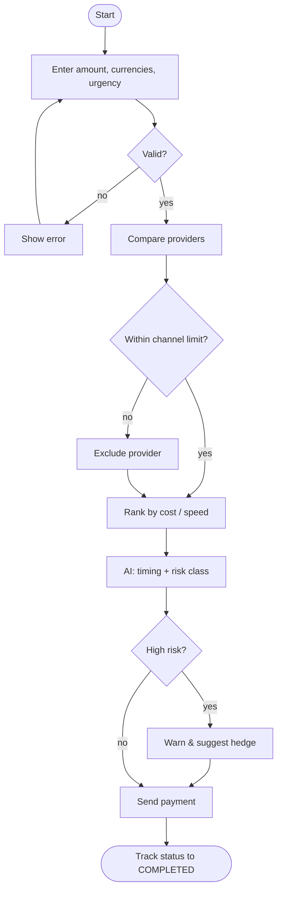

# UML Diagrams (Mermaid - renders on GitHub and in VS Code with a Mermaid preview extension)

## Architecture

## Use case

## Class diagram

## Sequence - send a payment

## Sequence - AI recommendation

## Activity - payment decision

